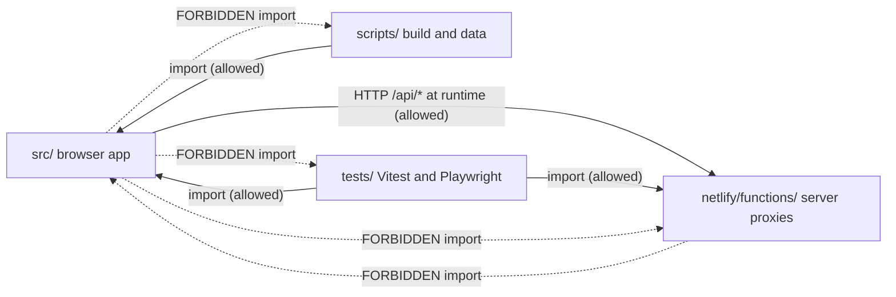

# Architecture

> Canonical, verified architecture reference for **sfl-crab / d1g.uk**. Read [AGENTS.md](../AGENTS.md) first for dev commands and conventions. This document goes deep on structure, routing, data flow, and subsystems. It replaces the old (stale, deleted) `overview.md`.

## What this app is

**d1g.uk** is a visual **Desert Digging Assistant** for [Sunflower Land](https://sunflower-land.com) players. Enter a Land ID and it renders a live 10×10 dig grid with crab/sand/treasure hints, today's treasure patterns, a practice mode, and shareable dig-day replays.

- **Vue 3 SPA** (Composition API, `<script setup>`) + Vite + Tailwind + DaisyUI
- **No app backend of its own.** The client talks to two external systems through thin **Netlify Function proxies** (`.cjs`, CommonJS):
  1. **Sunflower Land public API** — live farm/dig data (`sfl-api.cjs`)
  2. **SFL Digging Hub** (`HUB_API_BASE`, default `https://beta.api.d1g.uk`) — auth, dig-day snapshots, practice runs/patterns
- Deployed on **Netlify**. SPA uses `createWebHistory()`; the `_redirects` catch-all (`/* → /index.html`) is required.

> Note: the app *does* require env vars for the Netlify functions (SFL API keys, hub secrets, admin password). See [../env.example](../env.example). The old overview.md claim of "no backend / no env vars" was wrong.

## Game mechanics context

The 10×10 grid is the heart of the app. Full spec lives in [GRID_MECHANICS.md](./GRID_MECHANICS.md). Quick orientation:

- Grid is a flat array, `index = y * 10 + x`. Each tile is a `string[]` of CSS classes (**not** a typed object).
- **Crab** tiles are always orthogonally adjacent to a treasure. **Sand** is empty. **Treasure** tiles are surrounded by crabs. The hint engine exploits this invariant.
- Treasures appear in predefined **formation patterns** (`src/data/game/diggingFormations.js`). The API tells you which patterns are on a farm today; the app maps pattern keys → coordinate formations.
- A **seasonal artefact** (changes ~every 3 months) is resolved by `getCurrentSeasonalArtefact()` in `seasonalArtefacts.js`.

## Directory map

| Path | Purpose |
|---|---|
| `src/views/` | Page-level components (one per route target) |
| `src/components/` | Reusable UI (grids, pickers, modals, layout) |
| `src/composables/` | State + logic (Vue composables; app uses these instead of Vuex/Pinia) |
| `src/services/` | Network layer — calls the `/api/*` Netlify proxies |
| `src/utils/` | Pure helpers (grid builders, caches, codecs, asset resolution) |
| `src/router/` | Routes (`routes/digging.js`, `routes/public.js`, `routes/auth.js`) + guard |
| `src/config/` | `api.js` (env switching, hosts, endpoints), `support.js` |
| `src/constants/` | `storageKeys.js` — every localStorage key in one place |
| `src/data/game/` | **Auto-synced** game data (do not hand-edit) — formations, prices, constants, seasonal artefacts |
| `src/data/app/` | App constants (`constants.js`) |
| `src/features/` | `auth/` (login/callback views), `hub/hubClient.js` (auth headers) |
| `netlify/functions/` | Serverless proxies — see [../netlify/functions/README.md](../netlify/functions/README.md) |
| `scripts/` | Data sync + asset-check scripts (run by CI) |
| `public/world/` | Treasure/artefact sprites (`.webp`) |

## Routes

Assembled in `src/router/index.js` as `[...diggingRoutes, ...authRoutes, ...publicRoutes]`. History is `createWebHistory()` in the browser (`createMemoryHistory()` under SSR). One global guard: `router.beforeEach((to) => syncApiEnvFromRoute(to))` (`src/utils/landRoutes.js`) — reads `?testnet` from the URL and forces API env to `test`, else `production`. **There are no auth guards**; every route is public (`meta.public: true`).

### Digging routes (`src/router/routes/digging.js`)
| Path | Name | Renders |
|---|---|---|
| `/` | `Home` | redirect → `/digging` |
| `/digging` | `GuestDigging` | `GuestDigging.vue` |
| `/:landId(\d+)/digging` | `Digging` | `Digging.vue` |
| `/:landId(\d+)/digging/history` | `DiggingHistory` | `DiggingHistory.vue` |
| `/:landId(\d+)` | `DiggingAsHome` | redirect → `/:landId/digging` (keeps query + hash) |
| `/details` | `LandDetailsNoId` | `LandDetails.vue` |
| `/:landId(\d+)/details` | `LandDetailsWithId` | `LandDetails.vue` |
| `/todays-checklist` | `TodaysChecklist` | `TodaysChecklist.vue` |
| `/:landId(\w+)/todays-checklist` | `TodaysChecklistWithId` | `TodaysChecklist.vue` |
| `/practice` | `Practice` | `PracticeDigging.vue` |
| `/:landId(\d+)/practice` | `PracticeWithId` | `PracticeDigging.vue` |

`Digging.vue` is the live/interactive digging page (today only) with dig streak, free-digs-remaining, and live API sync. `DiggingHistory.vue` is a read-only historical viewer reached via `beforeEnter` redirect from old `?date=YYYY-MM-DD` query params on the `Digging` route (or direct navigation) — it displays the past-date dig grid, solver "guaranteed treasure" predictions, and dig-replay, but not live-only stats.

### Auth routes (`src/router/routes/auth.js`)
| Path | Name | Renders |
|---|---|---|
| `/login` | `Login` | `features/auth/LoginView.vue` (`meta.hideChrome`) |
| `/auth/callback` | `AuthCallback` | `features/auth/AuthCallbackView.vue` (`meta.hideChrome`) |

### Public routes (`src/router/routes/public.js`)
| Path | Name | Renders |
|---|---|---|
| `/feedbacks` | `FeedbackGallery` | `FeedbackGallery.vue` |
| `/admin` | `Admin` | `Admin.vue` (`meta.hideChrome`) |
| `/account` | `Account` | `Account.vue` |
| `/practice/run/:id` | `PublicPracticeRun` | `PublicPracticeRun.vue` |
| `/:landId(\d+)/dig-day` | `PublicDigDay` | `PublicDigDay.vue` |
| `/test/:pathMatch(.*)*` | `LegacyTestPath` | redirect via `legacyTestPathRedirect` → canonical path + `?testnet` |
| `/:pathMatch(.*)*` | (catch-all) | redirect → `/` |

`meta.hideChrome` hides the app nav/drawer chrome (login, callback, admin).

## Two Vite entrypoints

`vite.config.js` registers two Rollup inputs: `index.html` and `digging/index.html`. **Both load the exact same `/src/main.js` and the same Vue app** — there is no code-level difference in behavior. The only real deltas:

- `index.html` includes the Cloudflare Web Analytics beacon; `digging/index.html` does not.

The second physical entry exists so a direct hit to `/digging/` resolves to a real static HTML document that still boots the SPA (belt-and-suspenders alongside the `_redirects` catch-all). Treat them as the same app.

## Startup sequence (`src/main.js`)

1. **`initHubSession()`** runs *before* the app is created — migrates legacy nickname → display name, loads token/user from localStorage, ensures an anonymous UUID, refreshes the session if a token exists, and re-refreshes on window focus.
2. `createApp(App)` + `@vueuse/head` (`createHead()`) + router, mount to `#app`.
3. `initChatWidget()` after mount.
4. `useReliableAssets().autoRetryCriticalAssets` runs ~1s later to re-fetch critical CSS if it failed.
5. **Hot-deploy check** (`checkForUpdates()`): compares baked `__APP_VERSION__` (git SHA from `COMMIT_REF`, injected via Vite `define`) against the SHA in a fresh `no-cache` fetch of `/`. On mismatch it clears all CacheStorage and hard-reloads. Runs **once** at startup (not a repeating interval). It relies on Netlify setting `COMMIT_REF` at build time. Without it, `__APP_VERSION__` is an empty string and the check never reloads.

## API environment switching (`src/config/api.js`)

The app can target the SFL **production** or **test** API. This is orthogonal to the Hub.

- Hosts: production → `api.sunflower-land.com`; test → `api-dev.sunflower-land.com`.
- Persisted in localStorage `sfl-api-environment` (default `production`). `setApiEnvironment()` fires a `sfl-api-environment-changed` window event; `useApiEnvironment.js` keeps a reactive `ref` in sync.
- Endpoints go through the proxy: primary `/.netlify/functions/sfl-api/community/farms/`, fallback `/.netlify/functions/sfl-api/visit/` (visit often 401s for third-party tools).
- **`x-sfl-api-env: test`** header is added by `getApiHeaders()` only in test mode — that's how the `sfl-api` proxy knows to hit the api-dev host.
- **Cache-key prefixing** keeps prod/test data from mixing: `landData_${id}` vs `landData_test_${id}` (and `landCooldownEnd_...`). Empty id → `..._guest`.
- URL `?testnet` toggles env via the router guard. "Testnet" lands are heuristically all-digit IDs ≥13 digits (`src/utils/testnet.js`).

## localStorage keys (`src/constants/storageKeys.js`)

All keys live here — one source of truth. Fixed keys:

| Key | Purpose |
|---|---|
| `sfl-hub-session` | Hub auth JWT (Bearer) |
| `sfl-hub-user` | Cached hub user profile JSON |
| `sfl-hub-display-name` | Display name for dig-day / hub attribution |
| `sfl-hub-anonymous-id` | Stable anonymous UUID (practice pre-login) |
| `sfl-practice-nickname` | **@deprecated** — migrated → display-name on boot |
| `sfl-practice-save-scores` | Practice score submission toggle (`1`/`0`) |
| `sfl-api-environment` | SFL API target: `production` \| `test` |
| `theme` | DaisyUI theme name |
| `todays-checklist:landId` / `todays-checklist:selectedNpcIds` | Checklist page state |
| `digDaySync-<landId>` | Per-land opt-in for dig-day Hub sync (`1` = on, absent = off) |

Parameterized key builders: `landDataKey(id, testApi)`, `landCooldownKey(id, testApi)`, `gridCustomHintsKey(id)` → `gridCustomHints_${id}`, `markJournalKey(id, utcDate)` → `markJournal_${id}_${utcDate}`, `landUiPrefKey(id, pref)` → `${pref}-${id}`.

## Data flow (live land)

> Full request pipeline + caching policy: see [API_LAYER.md](./API_LAYER.md).

1. **Fetch** — every caller goes through `landFetchCoordinator.js` (`requestLandData()`), which applies single-flight, a 5-min localStorage freshness check, and the cooldown policy. It calls `landSyncService` → `landApiService.js` → `/.netlify/functions/sfl-api/community/farms/:id` → SFL API.
2. **Response shape** — `{ visitedFarmState: { desert: { digging: { grid, patterns, completedPatterns } } } }`. Grid tiles are `{ x, y, items: { Crab | Sand | <TreasureName> }, dugAt, tool }`.
3. **Store** — `useLandData.js` holds reactive land data + localStorage cache, keyed per land + API env, UTC-date-stamped (stale after the UTC date changes).
4. **Render** — `useGridEngine.js` converts API tiles → CSS class arrays and rebuilds neighbor hints (`near-*`). See [GRID_MECHANICS.md](./GRID_MECHANICS.md).
5. **Cooldowns** — 15s between successful refreshes, 30s after failures, armed by the coordinator on every network hit (`useLandSync.js` only renders the countdown UI).

## Key composables

| Composable | Role |
|---|---|
| `useGridEngine.js` ⭐ | Core 10×10 grid + auto neighbor-hint propagation |
| `useGridManager.js` | User marks / manual hint cycling |
| `useLandData.js` ⭐ | Central land-data store + localStorage cache; `solverPatternKeys` is the historical-aware solver-input source shared by Grid.vue/TodayPatterns.vue on both digging pages |
| `useLandSync.js` | Refresh UI state (isLoading/isCooldown/countdown) — network decisions delegated to `landFetchCoordinator` |
| `useDigDayStore.js` | Opt-in (default off) Hub dig-day sync (debounce/ETag/merge) — see [DIG_DAY_SYNC.md](./DIG_DAY_SYNC.md) |
| `usePracticeEngine.js` / `usePracticePatterns.js` | Practice mode grid generation + daily patterns |
| `useHintsStorage.js` | Per-land per-UTC-day hint persistence |
| `useMarkJournal.js` / `usePatternMarks.js` / `markJournalBridge.js` | Mark event journal (feeds dig-day sync + replays) |
| `useDigReplay.js` | Read-only step-by-step replay player |
| `useHubSession.js` | Auth session bootstrap + refresh |
| `useApiEnvironment.js` | Reactive prod/test API env |
| `useReliableAssets.js` / `useSoftReload.js` | Critical asset retry + soft reloads |
| `useTodayTreasureNames.js` | Pattern keys → treasure names |

## Services (`src/services/`)

All hit the `/api/*` Netlify proxies — per-service reference in [../src/services/README.md](../src/services/README.md). `landFetchCoordinator.js` ⭐ is the single door to the SFL farm API (single-flight, freshness, cooldown — see [API_LAYER.md](./API_LAYER.md)); `landApiService.js`, `landSyncService.js`, `digDayApiService.js`, `hubAuthService.js`, `hubProfileService.js`, `practiceHubService.js`, `practicePatternService.js`, `practiceRunApiService.js`, `adminBlobService.js`. Hub calls attach `Authorization: Bearer <token>` via `src/features/hub/hubClient.js` when a session exists.

## Grid builder utils (the 4 overlapping files)

These form a **producer/consumer pipeline** around a common `DigStep[]` shape (`{ order, dugAt, tiles: [{ x, y, items, tool }] }`). This overlap is intentional — do not "dedupe" them blindly.

**Producers of `DigStep[]`:**
- `buildDigTimeline.js` ⭐ — parses the **raw live API grid** into the canonical `DigStep[]` (groups multi-tile Sand Drill digs into one step, sorts by `dugAt`, 1-based `order`). Also exports `getTodayUTC`, `getCurrentDigOrder`, `buildTreasureOrderMap`, `buildDigStats`. **Everything else depends on this file.**
- `buildPracticeDigTimeline.js` — the **inverse**: synthesizes the same `DigStep[]` from the local practice engine's `digHistory` + `hiddenGrid`, so practice runs reuse the same replay/public builders.

**Consumers of `DigStep[]`:**
- `buildReplayGrid.js` — `buildReplayCellsAtStep(digs, stepOrder, marksByCell)` renders **intermediate replay state at an arbitrary step k** into per-cell CSS class arrays (instantiates `useGridEngine`).
- `buildPublicDigGrid.js` — `buildPublicDigView(digs, markEvents)` builds the **complete final grid** for a saved public dig-day: resolves mark-event history, treasure-order map, and item icon metadata. Internally pins `buildReplayCellsAtStep` to the last step.

The two order-map helpers (`buildTreasureOrderMap` from raw grid vs `buildTreasureOrderMapFromDigs` from `DigStep[]`) differ only by input source.

## Dead code / gotchas register

Known non-functional or trap-laden spots. Documented so an AI doesn't waste time or "fix" load-bearing weirdness:

| Item | Status |
|---|---|
| `netlify/functions/projectmate-feedback.cjs` | **Routed, opt-in** — still routed by `netlify.toml` and `public/_redirects` (`/api/projectmate/*` → `/issues*`). No code in `src/` calls `/api/projectmate` by default. It is used only if `VITE_PROJECTMATE_ISSUES_ENDPOINT=/api/projectmate` is set; otherwise the widget talks to the Worker directly. |
| Tile stringly-typing | Tiles are `string[]` of CSS classes, not objects. Fragile by design — see GRID_MECHANICS.md before touching. |

## Dependency rules

Enforced by `npm run check:deps` (dependency-cruiser, config in `.dependency-cruiser.cjs`). `npm run check` runs it with the dead-code check, the tests and the build.

1. `src/` must not import from `netlify/`, `tests/` or `scripts/`.
2. `netlify/` must not import from `src/`.
3. No circular imports. The one exception is the recursive component `src/components/KeyValueList.vue`, which renders itself.

The browser calls the Netlify functions over HTTP (`/api/*`), never by import. That is why the rules only cover imports.

**The `@/` alias** maps to `src/`. It is defined in `jsconfig.json` (`paths: { "@/*": ["src/*"] }`), which dependency-cruiser reads through its `tsConfig` option, and in `vite.config.js` for the build.

**Commands**

- `npm run check:deps`: the three rules above.
- `npm run check`: `check:deps` + `check:dead` + `test` + `build`. The `test-and-build` job in `.github/workflows/ci.yml` runs it on PRs and on pushes.

## Where new code goes

| Adding | Put it in | Notes |
|---|---|---|
| Reusable Vue UI (grids, pickers, modals, layout) | `src/components/` | |
| Stateful logic (Vue composable) | `src/composables/` | The app does not use Vuex or Pinia |
| Call to a Netlify proxy | `src/services/` | Land data goes only through `landFetchCoordinator.js` |
| Pure helper (grid builders, caches, codecs) | `src/utils/` | No Vue state |
| Page-level view for a route | `src/views/` | |
| Route or route guard | `src/router/` | |
| Login, callback, Hub auth | `src/features/` | |
| API environment, endpoints | `src/config/` | |
| localStorage key names | `src/constants/storageKeys.js` | |
| Auto-synced game data | `src/data/game/` | Do not hand-edit |
| Server proxy | `netlify/functions/` | CommonJS `.cjs` only |
| Data sync, asset check, debug CLI | `scripts/` | |
| Unit and E2E tests | `tests/` | |
| Treasure and artefact images | `public/world/` | `.webp` |

## Architecture diagram

Solid arrows are allowed. Dashed arrows are forbidden imports, which `npm run check:deps` rejects.

## Dead-code baseline

`npm run check:dead` runs knip with `knip.json`. The findings that already exist are listed in `knip.json` as a baseline. The baseline may only shrink. Do not add entries to it. When you delete the code an entry names, delete the entry too.

## Environment

For `netlify dev`, copy `env.example` (detailed) or `.env.example` (terse) to `.env` and set:

| Var | Purpose |
|---|---|
| `SFL_API_KEY` / `SFL_API_KEY_DEV` | Server-side SFL API keys |
| `HUB_API_BASE` | Dig-day and hub-auth backend URL |
| `HUB_WRITE_SECRET` | Guest dig-day write secret |
| `ADMIN_PASSWORD` | `/admin` page auth |
| `PROJECTMATE_WORKER_URL` / `PROJECTMATE_ADMIN_KEY` | **Optional.** Only for the same-origin `/api/projectmate/*` proxy. Unset means the proxy returns 503 and the widget uses the Worker directly |
| `VITE_*` vars | Client-side, safe to expose |

`VITE_API_PROXY_TARGET` is covered in [Netlify and Vite details](#netlify-and-vite-details).

## Local run, build and browser checks

- `npm run dev` is `netlify dev` (functions on :8888, Vite on :5173). Use it for anything that touches functions (auth, dig-day, practice patterns). `npm run dev:vite` is Vite only, and `/api` proxies to `beta.d1g.uk`.
- Build check: `npx vite build` (~8s; also catches template and compile errors). Serve it with `npx vite preview --port 4319 --strictPort`, which serves `dist/` with SPA fallback.
- `vite preview` does **not** run the Netlify functions, so `/api/*` returns 404. "Today's Patterns" then falls back to a Random Round. That is fine for client-only checks. Use `npm run dev` for function-backed flows.
- Routes to smoke-test: `/`, `/digging`, `/practice`, `/:landId/digging`, `/:landId/digging/history`, `/:landId/practice`.
- **Digging a tile takes two clicks plus a delay.** The first click arms confirm, and the second digs after `DIG_DELAY_MS` (350 ms). When scripting, click a `.tile` twice, then wait about 500 ms.
- The grid is 100 `.tile` divs. "Digs:", "Round N" and "Shared Grid" are read from spans and `.badge`.
- An in-progress practice round persists to `localStorage['practice:in-progress-round:1']`.
- The practice board link (`?board=`) is self-contained: base64url of JSON `[[key,ox,oy],...]`. The same board gives the same code. The same patterns with a new layout give the same key multiset but a different code.
- Ignore CORS errors from `cloudflareinsights.com/cdn-cgi/rum` in the console. That is external RUM analytics, not app code.
- Solver changes and grid-transform changes also need `npm test` first. See [SOLVER.md](./SOLVER.md).

**Tooling.** Prettier is installed but has no config file. There is no ESLint and no lint script.

## Netlify and Vite details

- `netlify.toml`: functions live in `netlify/functions`, bundled with `node_bundler = "esbuild"`, with `@netlify/blobs` marked `external_node_modules`. Node is 22 (`NODE_VERSION`).
- `pretty_urls = false` stops Netlify from redirecting `/digging` to `/digging/` before the `/digging` rule runs.
- The SPA fallback is `/* → /index.html`. Redirect rules are also in `netlify.toml` as a backup for `public/_redirects`.
- `[dev]` runs `npx vite` on :5173 behind `netlify dev` on :8888.
- `vite.config.js` proxies `/api` in `npm run dev:vite`. The default target is `https://beta.d1g.uk`. Set `VITE_API_PROXY_TARGET=http://localhost:8888` in `.env` to use local functions instead.
- Vite `define` bakes `__APP_VERSION__` from the `COMMIT_REF` environment variable (see [Startup sequence](#startup-sequence-srcmainjs)).

## CI and monitoring

- `.github/workflows/ci.yml`: the `test-and-build` job runs `npm run check` on every PR and on pushes to `master` and `development`. It uses the Node version in `.nvmrc`.
- `.github/workflows/health-check.yml` runs every 6 hours (cron `17 */6 * * *`) and on demand. It runs `scripts/health-check.js`, which checks the live sfl-api proxy for land 1, `/api/practice-patterns`, and the Hub `/health` endpoints.
- On failure, the job opens or comments on a GitHub issue labelled `health-check` and exits non-zero. A later passing run closes the open `health-check` issues.
- Scheduled workflows run only from `master`. `workflow_dispatch` needs the file on `master` too.
- Run the check locally with `node scripts/health-check.js`. It sends GET requests only, to public d1g.uk URLs, and needs no secrets. Override targets with `SITE_URL` and `HUB_URL`. The pure validators are tested in `tests/healthCheck.test.js` (no network).

## Auto-synced data

`src/data/game/` is synced from the Sunflower Land repo by CI. Do not hand-edit these files.

- `treasurePrices.json` and `gameConstants.json`: `npm run sync-game-data`, weekly in CI (Sundays 00:00 UTC).
- `seasonalArtefacts.js`: `npm run sync-artefact`, monthly in CI.
- `diggingFormations.js`: imported from game data.

Three GitHub Actions workflows auto-commit to the repo: `sync-game-data.yml`, `sync-artefact.yml` and `warm-daily-cache.yml`.

Both sync workflows commit and push to `master`, then mirror the data files to `development` with a file-level checkout (`src/data/game/`, plus `public/world/` for the artefact). The mirror has no fast-forward requirement, so there are no merge conflicts. The mirror is skipped with a warning if `development` has local edits to those paths that `master` does not have. Result: prod (`master`) and beta (`development`) stay on identical game data.

## Related docs

- [decisions/](./decisions/README.md) — architecture decision records (ADRs)

- [AGENTS.md](../AGENTS.md) — dev commands, conventions, env, API proxy quirks
- [API_LAYER.md](./API_LAYER.md) — SFL farm API request pipeline + caching/cooldown policy
- [GRID_MECHANICS.md](./GRID_MECHANICS.md) — grid engine, hints, formations, practice mode
- [DIG_DAY_SYNC.md](./DIG_DAY_SYNC.md) — dig-day hub sync (debounce/ETag/merge)
- [HUB_CONSUMPTION_SPEC.md](./HUB_CONSUMPTION_SPEC.md) — hub ETag/idempotency spec
- [../netlify/functions/README.md](../netlify/functions/README.md) — per-function reference
- [../src/data/game/README.md](../src/data/game/README.md) — auto-synced game data
- [../SEASON_UPDATE_GUIDE.md](../SEASON_UPDATE_GUIDE.md) — seasonal artefact updates
- [../API_KEY_SETUP.md](../API_KEY_SETUP.md) — SFL API keys
